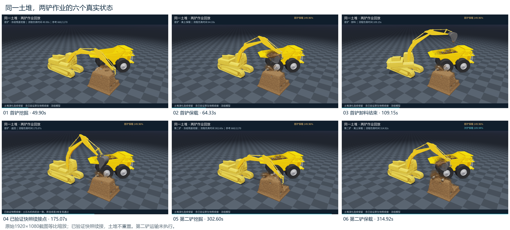

# 复杂介质工况自主挖掘

面向自主挖掘与装车的仿真研究项目，结合 MPM 土体仿真、四轴轨迹控制、残差强化学习和带载运输补偿。`main` 保存最终源码、恢复工具和项目记录。

**[查看效果](#项目效果)** · **[快速恢复](#快速恢复)** · **[下载最终 PPT、视频与图片](https://github.com/Bibabuuuu/wajueji/releases/tag/final-archive-20261023)**

## 项目效果



| 内容 | 最终记录 |
| --- | --- |
| 首铲短保载显示满斗率 | **149.96%（约 150%）** |
| 第二铲短保载显示满斗率 | **109.94%（约 110%）** |
| 两铲衔接 | 首铲挖掘、运卸、返回后，通过已核验的原生快照续接第二铲，土堆不重置 |
| 带载举升减振 | 独立运输验证中，斗姿误差峰值 **4.00° → 1.91°**，RMS **1.52° → 0.57°** |

两铲均完成 1170 参考帧及 0.5 秒保载。满斗率为含堆尖的仿真显示指标，尚未标定为实际装车净体积；第二铲运输、第三铲、跨场景成功率及实机部署尚未验收。减振修复完成后，未重新运行完整两铲链路。详细范围见[当前状态](docs/CURRENT_STATUS.md)与[实验记录](reports/github-handoff-20261015/)。

完整路演视频、最终 17 页 PPT、PPT 内嵌视频和图片、可编辑流程图及答辩稿，统一下载[最终材料包](https://github.com/Bibabuuuu/wajueji/releases/download/final-archive-20261023/wajueji-final-materials-20261023.zip)。

## 快速恢复

**运行项目：下载 [独立恢复包（约 300 MB）](https://github.com/Bibabuuuu/wajueji/releases/download/portable-restore-20261024/wajueji-portable-restore-20261024.tar.gz)。** 它已包含冻结源码、模型与贴图、策略权重、参考轨迹、关键状态和运行后端，无需原来的代码或资源目录。兼容的 Linux/NVIDIA、Python 与依赖环境需要另行准备。

将下载的压缩包放入准备好的环境后执行：

```bash
tar -xzf wajueji-portable-restore-20261024.tar.gz
cd wajueji-portable-restore
python restore.py check
python restore.py smoke --output ./outputs/first-smoke
```

`check` 校验包内文件；`smoke` 恢复冻结状态、加载策略并执行 3 个物理帧，同时检查显示模型和土壤表面生成。独立目录短检已通过：24 类初态数组一致，原生恢复误差为 0，7 个原项目资源目录访问为 0。此项验证覆盖恢复启动，未重新验收完整挖掘或运输。

[恢复使用说明](deployment/README.zh-CN.md) · [恢复包与 SHA256 校验文件](https://github.com/Bibabuuuu/wajueji/releases/tag/portable-restore-20261024) · [验证回执](deployment/restore-verification-20261024.json)

**阅读或修改源码：**

```bash
git clone https://github.com/Bibabuuuu/wajueji.git
cd wajueji
```

Git 仓库保存源码和小型记录；大型运行资源从上面的独立恢复包获取。GitHub 自动生成的 `Source code (zip/tar.gz)` 不含这些外部运行资源。

## 代码与文档

| 入口 | 内容 |
| --- | --- |
| [src/v4/](src/v4/) | 四轴仿真、控制、策略与运行逻辑 |
| [configs/](configs/) | 场景与实验配置 |
| [deployment/](deployment/) | 独立恢复、打包工具和验证回执 |
| [tests/](tests/) | 已有测试 |
| [reports/](reports/) / [evidence/](evidence/) | 实验摘要、冻结结果与核验记录 |
| [项目总体规划](docs/PROJECT_PLAN.md) / [当前状态](docs/CURRENT_STATUS.md) | 项目范围与最终进度 |
| [文档索引](docs/DOCS_INDEX.md) / [归档说明](docs/FINAL_ARCHIVE.md) | 详细技术文档与历史归档入口 |

最终材料仅保留提交版 PPT；大型媒体与恢复包放在 Release。历史实验记录和失败结论保留在文档与归档中，既有发布标签和冻结源码保持不变。
